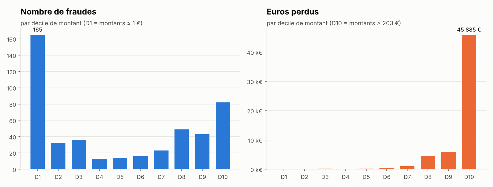
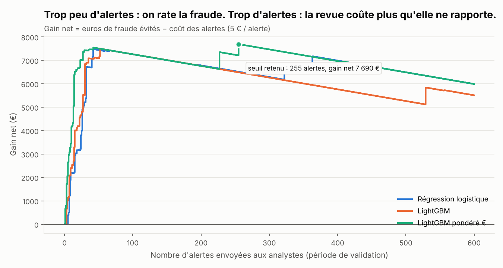
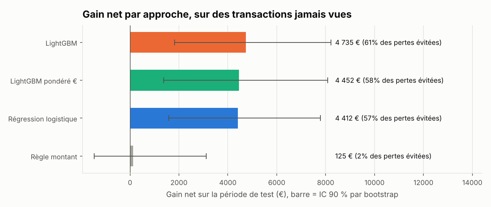
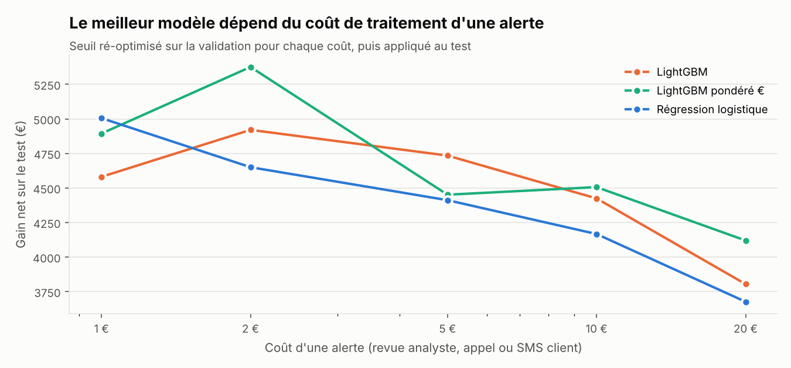
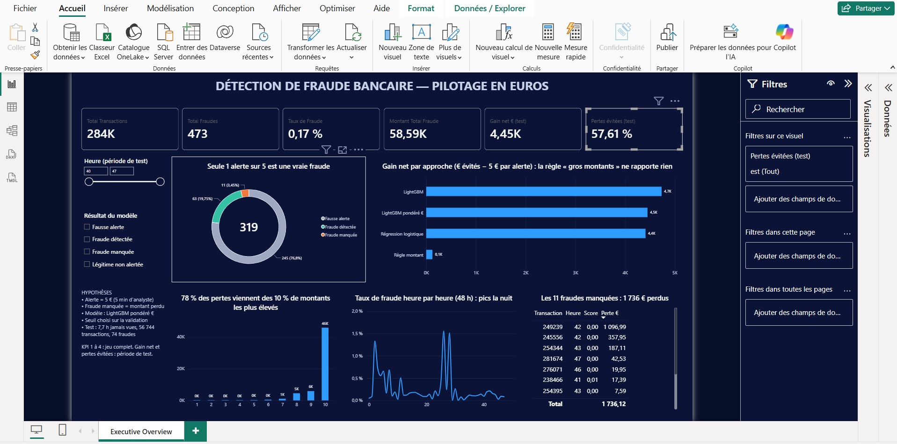

# Détection de fraude bancaire : du score de risque au gain en euros

> **Question métier :** combien de pertes une banque peut-elle éviter grâce à un modèle de détection de fraude, et combien d'alertes ses analystes doivent-ils traiter pour y parvenir ?

`SQL (DuckDB)` · `Python` · `scikit-learn` · `LightGBM` · `Power BI` · `pytest`

---

## Résultats en bref

Sur la période la plus récente (7,7 heures, 56 744 transactions, jamais vues pendant l'entraînement) :

| | Sans modèle | Règle « gros montants » | **Modèle retenu (LightGBM pondéré €)** |
|---|---|---|---|
| Pertes dues à la fraude | 7 728 € | 6 223 € | **1 736 €** |
| Fraudes détectées | 0 / 74 | 1 / 74 | **63 / 74** |
| Alertes à traiter | 0 | 276 | **308** (≈ 40 par heure) |
| **Gain net** (€ évités − 5 € par alerte) | 0 € | 125 € | **4 452 €, soit 58 % des pertes évitées** |

- **Le montant seul ne permet pas de repérer la fraude** : la règle « contrôler les gros montants » ne rapporte quasiment rien.
- **Les modèles évitent 57 à 61 % des pertes.** Leurs intervalles de confiance se chevauchent : avec 74 fraudes en test, aucun ne bat les autres de façon certaine.
- **La vraie décision est opérationnelle.** À gain comparable, LightGBM sans pondération envoie 8 alertes par heure (87 % de vraies fraudes), contre 40 par heure pour le modèle retenu (20 % de vraies fraudes). Si l'équipe de revue est petite, c'est lui qu'il faut déployer.

---

## 1. Le constat qui oriente tout le projet



Compter les fraudes et compter les euros donnent deux images opposées (`sql/02_fraud_profile.sql`) :

- **36 % des fraudes portent sur des montants ≤ 1 €** (171 fraudes, 132 € au total). C'est la signature du *card testing* : le fraudeur vérifie qu'une carte volée fonctionne.
- **10 % des transactions (les plus élevées, > 203 €) concentrent 78 % des pertes.** 20 % des fraudes représentent 82 % des euros perdus.

Un modèle jugé sur le *nombre* de fraudes détectées peut donc être bon sur le papier et médiocre en euros. **Tout le projet est évalué en euros.**

## 2. Méthode

| Étape | Choix | Pourquoi |
|---|---|---|
| Qualité des données | 1 081 doublons exacts supprimés (dont 19 fraudes), contrôle des valeurs manquantes et des montants nuls | Un doublon présent à la fois en apprentissage et en test gonfle artificiellement le score |
| Découpage | **Temporel** : 60 % des transactions les plus anciennes pour l'apprentissage, 20 % suivants pour la validation, 20 % les plus récents pour le test | Reproduit la production : on apprend sur le passé, on prédit le futur. Le test n'est utilisé qu'une fois |
| Métriques | PR-AUC pour classer les modèles, **gain net en euros** pour décider | Avec 0,167 % de fraude, un modèle qui ne détecte jamais rien a 99,83 % d'accuracy |
| Seuil d'alerte | Optimisé en euros sur la validation, pas fixé à 0,5 | Le seuil est une décision métier : chaque alerte coûte du temps d'analyste |
| Modèles | Règle métier, régression logistique, LightGBM, LightGBM pondéré par le montant | Partir du plus simple et justifier chaque gain de complexité |
| Incertitude | Intervalle de confiance à 90 % par bootstrap | 74 fraudes en test : un chiffre seul donnerait une fausse impression de précision |

**Hypothèses de coût** (`src/fraud/config.py`) : une alerte coûte 5 € (environ 5 minutes d'analyste à 60 €/h chargé), une fraude manquée coûte son montant (remboursé au client), une fraude détectée évite cette perte.

## 3. Choisir le seuil en euros



Les premières alertes sont presque toutes des fraudes coûteuses : le gain monte très vite. Ensuite, chaque alerte coûte 5 € et rapporte de moins en moins. Le seuil retenu est le sommet de la courbe en validation.

## 4. Résultats sur des transactions jamais vues



| Approche | Alertes | Fraudes détectées | Précision | € évités | Gain net | IC 90 % | PR-AUC |
|---|---|---|---|---|---|---|---|
| Règle montant | 276 | 1 / 74 | 0 % | 1 505 € | 125 € | [−1 460 ; 3 120] | 0,001 |
| Régression logistique | 49 | 47 / 74 | 96 % | 4 657 € | 4 412 € | [1 579 ; 7 790] | 0,744 |
| LightGBM | 62 | 54 / 74 | 87 % | 5 045 € | 4 735 € | [1 826 ; 8 225] | 0,796 |
| **LightGBM pondéré €** (retenu) | 308 | 63 / 74 | 20 % | 5 992 € | 4 452 € | [1 374 ; 8 087] | 0,798 |

Le modèle a été retenu parce qu'il avait le meilleur gain net **en validation**. Il n'est pas le meilleur sur le test : c'est attendu quand les écarts sont dans le bruit, et c'est la raison pour laquelle on ne choisit jamais un modèle sur le test. Ses 11 fraudes manquées représentent 1 736 €, dont une seule à 1 097 €.

## 5. Le paramètre qui compte le plus : le coût d'une alerte



Pour chaque coût, le seuil est ré-optimisé sur la validation puis appliqué au test. Le gain reste solide (environ 3 700 à 5 400 € selon les scénarios) et le classement des modèles change selon le coût. **Le premier chiffre à obtenir auprès du métier n'est pas un hyperparamètre : c'est le coût réel d'une alerte et la capacité de l'équipe de revue.**

## 6. Dashboard Power BI

Les tables prêtes à l'emploi sont dans `powerbi/exports/`. Le plan du rapport, les mesures DAX et une simulation interactive du coût d'une alerte sont décrits dans [`powerbi/README.md`](powerbi/README.md).



## Limites

- **2 jours de données (septembre 2013)** : impossible de mesurer la dérive dans le temps ou la saisonnalité.
- **Variables anonymisées** : V1 à V28 sont issues d'une ACP. On sait que V14, V10 et V17 pèsent le plus (`reports/figures/05_feature_importance.png`), pas ce qu'elles représentent. Impossible donc d'expliquer une alerte à un analyste.
- **Coûts simplifiés** : le coût d'une alerte est une hypothèse, et la gêne d'un client bloqué à tort n'est pas chiffrée.
- **Heure de la journée** : on suppose que la collecte démarre à minuit, ce que la source ne garantit pas.
- **Faible nombre de fraudes en test** : les gains donnent un ordre de grandeur, d'où les intervalles de confiance.
- **Écart découpage aléatoire / temporel** : la PR-AUC de LightGBM passe de 0,820 (aléatoire) à 0,796 (temporel). L'écart est modeste ici, mais seul le découpage temporel correspond à l'usage réel.

## Structure du projet

```
├── sql/
│   ├── 00_load.sql             chargement, dédoublonnage, variables temporelles
│   ├── 01_data_quality.sql     volumétrie, doublons, valeurs manquantes, montants
│   └── 02_fraud_profile.sql    déciles (NTILE), Pareto (SUM OVER), moyenne glissante, RANK
├── src/fraud/
│   ├── data.py                 nettoyage et découpage temporel
│   ├── features.py             variables (log montant, heure cyclique)
│   ├── models.py               règle métier, régression logistique, LightGBM
│   ├── costs.py                traduction des prédictions en euros, choix du seuil, bootstrap
│   └── plots.py                graphiques
├── scripts/
│   ├── download_data.py        téléchargement Kaggle et vérification MD5
│   ├── run_sql.py              exécute les requêtes et exporte les résultats
│   └── run_pipeline.py         modèles, seuils, sensibilité, figures, exports Power BI
├── notebooks/analyse_fraude.ipynb   l'analyse racontée pas à pas
├── reports/                    figures, résultats SQL, métriques
├── powerbi/                    exports CSV et guide du dashboard
└── tests/                      tests de la logique financière et du découpage
```

## Reproduire

```bash
pip install -r requirements.txt
make all        # ou, étape par étape :
python scripts/download_data.py   # nécessite un token Kaggle (voir data/README.md)
python scripts/run_sql.py
python scripts/run_pipeline.py
python -m pytest -q tests
```

Durée : 1 à 2 minutes sur un ordinateur portable, hors téléchargement. Résultats déterministes (graine fixée).

## Données et point de départ

- Données : [Credit Card Fraud Detection](https://www.kaggle.com/datasets/mlg-ulb/creditcardfraud), Machine Learning Group de l'ULB et Worldline. 284 807 transactions de cartes européennes sur 2 jours, dont 492 fraudes.
- Point de départ : le notebook Kaggle [Credit Card Fraud Detection Predictive Models](https://www.kaggle.com/code/gpreda/credit-card-fraud-detection-predictive-models), qui compare plusieurs algorithmes de classification. Ce projet part de la même question mais l'oriente vers la décision métier : découpage temporel, seuil optimisé en euros, comparaison avec une règle simple, incertitude et sensibilité aux hypothèses de coût.
